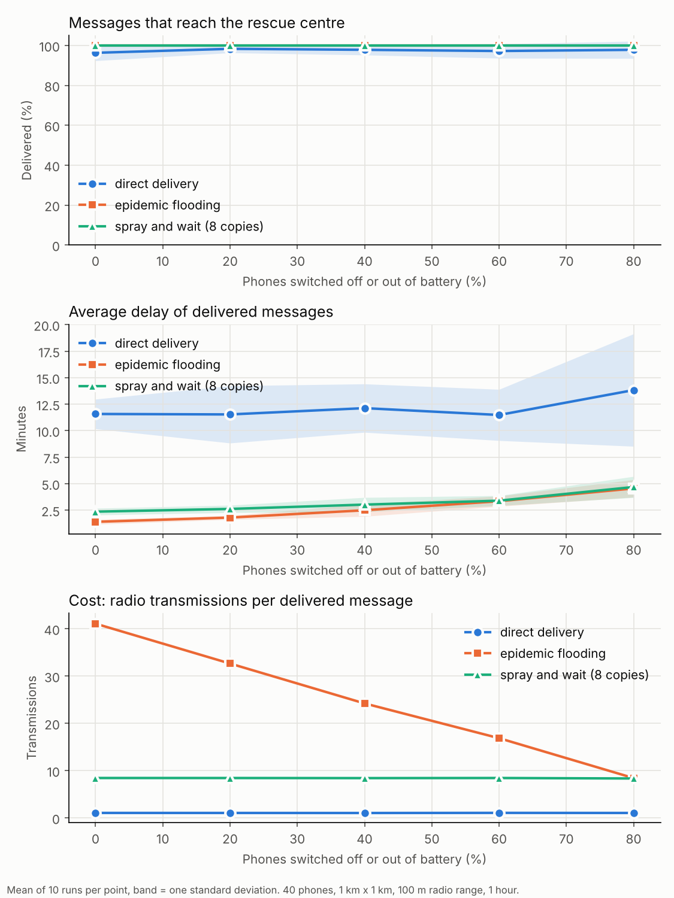
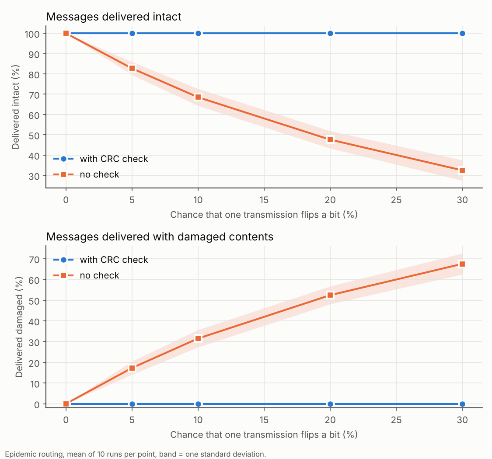

# Emergency message relay simulation

When a flood or storm knocks out the phone network, phones can still pass messages to each other when they come within radio range, like notes passed across a classroom. This simulation tests how well that works and what it costs. Written in Python with numpy.

## The scenario

- 40 phones walk or cycle (1 to 5 m/s) around a 1 km x 1 km area, moving between random points.
- One fixed phone in the middle is the **rescue centre**. Messages must reach it.
- Two phones within 100 m of each other swap messages. Each phone stores what it carries and passes it on.
- 100 messages of 32 bytes are created in the first 20 minutes, and the run lasts 1 hour. Every result is the mean of 10 random runs.
- Every message carries a **CRC-32 checksum**. A receiver that sees a mismatch drops the message, and the sender tries again at the next meeting.

## Experiment 1: three ways to forward messages

- **Direct:** a phone holds its message until it meets the rescue centre.
- **Epidemic:** phones copy every message to every phone they meet.
- **Spray and wait:** each message starts with 8 copies, which are handed out in halves. Phones holding one copy wait for the centre.



| Phones offline | Router | Delivered | Average delay | Transmissions per message |
|---|---|---|---|---|
| 0 % | direct | 96 % | 11.6 min | 1.1 |
| 0 % | epidemic | 100 % | 1.4 min | 41.1 |
| 0 % | spray and wait | 100 % | 2.4 min | 8.4 |
| 80 % | direct | 98 % | 13.8 min | 1.0 |
| 80 % | epidemic | 100 % | 4.6 min | 8.4 |
| 80 % | spray and wait | 100 % | 4.7 min | 8.3 |

What the results show:
- **Relaying helps speed more than delivery.** Even direct delivery reaches about 97 % of messages within an hour, probably because every phone wanders past the centre within an hour (not tested separately). Relaying makes messages arrive roughly 5 to 8 times sooner when phones are working.
- **Spray and wait is the best trade-off here.** It costs about 5 times fewer radio transmissions than epidemic flooding (8.4 against 41.1) for about one extra minute of delay.
- **Offline phones slow things down.** Epidemic delay rises from 1.4 to 4.6 minutes as phones go offline.
- **Caveat:** offline phones create no messages here, so this experiment does not count messages lost on dead phones. It measures how well working phones can still get their messages through.

## Experiment 2: what the checksum prevents

Each transmission has a chance of flipping one random bit. With epidemic routing:



| Bit-flip chance | With CRC: intact / damaged | Without a check: intact / damaged |
|---|---|---|
| 5 % | 100 % / 0 % | 83 % / 17 % |
| 10 % | 100 % / 0 % | 68 % / 32 % |
| 30 % | 100 % / 0 % | 32 % / 68 % |

A test also confirms that CRC-32 catches every possible single-bit flip in a message.

## Run it

```bash
pip install -r requirements.txt
python relay_sim.py        # both experiments, about a minute, saves results/*.png
python -m pytest -q        # 6 tests
```

## Limitations

- Phones move in a random-waypoint pattern, which is not how people move in a real disaster.
- Radio is simplified: a fixed range, no collisions or interference, and unlimited phone storage. Delivered messages are not deleted from phones.
- Corruption is modelled as a single bit flip. A CRC detects accidental damage only. It cannot stop someone deliberately changing a message.
- One area size and phone count. The results are about these settings, not a general claim.

## Next steps

- Add a deadline metric ("delivered within 5 minutes"), which should show the benefit of relaying more clearly.
- Add limited phone storage and message priorities, such as "medical" before "status".
- Add a message authentication code (HMAC) so tampering is detected, not only accidental damage.
